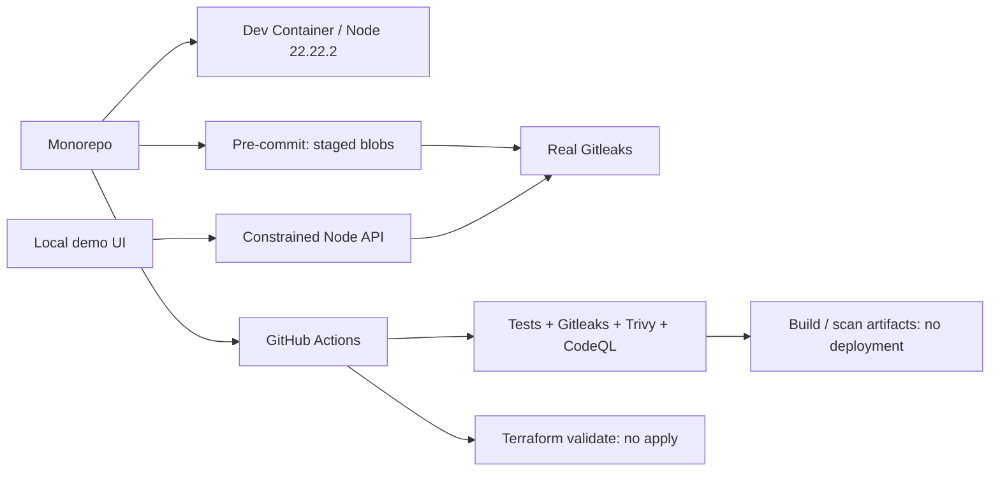

# SENTINEL — Secure Development Platform PoC

> Local proof. Explicit boundaries. 一个可运行、可讲解、无云资源的统一安全开发环境作品。

**最短演示路径：** Windows 双击 `start-demo.cmd`，浏览器打开 http://127.0.0.1:4173，进入 **Live demo**，依次点击泄露与修复。不要只展示配置截图：两个按钮都会运行真正的 Gitleaks。**Local AI** 页签用本机 LM Studio 做检索问答，数据不出本机。

## 为什么这样取舍

客户需求尚未完整，本版验证“同仓库、同环境、可执行安全门禁、可复现交付”的技术路径。先展示真实的安全闭环，不为演示引入 Kubernetes、云账号、数据库、登录系统、付费 AI 或模型训练。**不是已投入生产的企业开发平台，也不表示已经统一了客户全体开发人员的环境。**

- 运行时：Node.js **22.22.2**，只用标准库，无 npm 第三方运行依赖。
- 工具：Gitleaks **8.30.1**、Trivy **0.76.1**、Terraform **1.16.6**。
- 成本：本地演示不创建云资源、无付费 API；首次下载工具、容器镜像及扫描库需要联网。后续 Actions/Codespaces 是否免费取决于仓库、账户和用量，不能承诺无限免费。
- 统一：服务 `apps/sample-service` + 共享安全模块 `packages/security-policy` 同仓库维护，开发容器、CI 和 `.nvmrc` 对齐版本。

## 启动

### Windows 当前机器

双击 `start-demo.cmd`，保持终端开启，访问 http://127.0.0.1:4173。脚本优先使用本机已安装的隔离运行时；其他电脑使用 PATH 中的 Node/Python。端口已被占用时先检查是否已经启动，不要反复开多个服务。

### 其他电脑 / 标准终端

需要 Node 22.22.2、Python 3、Git；**展示网页和密钥闭环不需要 Docker**。

```sh
python scripts/bootstrap-tools.py gitleaks
node apps/sample-service/server.mjs
```

Python 只用标准库，不需 pip；部分 Linux/macOS 使用 `python3`。工具只写入本仓库 `.tools/`，不会修改系统 PATH。下载先比对官方 HTTPS manifest 的 SHA256，再提取唯一可执行文件；这不是签名验证，也不是完整供应链认证。

在另一终端验证：

```sh
node --test
node scripts/smoke.mjs
```

完整本地证据（含可能被环境阻断的项目）：

```sh
python scripts/bootstrap-tools.py gitleaks terraform trivy
node scripts/verify.mjs
```

输出 `outputs/evidence.json`；原始 `tests.tap` 和脱敏演示结果按 `runId` 存入 `outputs/runs/<runId>/`。完整批次结束后原子更新快照；中途失败保留上一次完整快照及其原始证据，不会混合不同批次。验证器退出码：`0` 无失败/阻断、`1` 存在失败、`2` 存在环境阻断；`not_run` 不等于通过。界面的 Evidence 读取真实快照，只有手动刷新，不伪造 CI 状态。

### Dev Container

1. 启动 Docker Desktop/Linux Engine；先确认 `docker info` 能返回服务端版本。
2. clone 本仓库；如下载 ZIP 则先 `git init -b main`。
3. 在 VS Code 的 Dev Containers 扩展中选择 **Reopen in Container**。
4. 初始化会安装固定工具并接入 Git hook；运行 `node --test` 和 `node apps/sample-service/server.mjs`。

容器是非 root `node` 用户、不挂 Docker socket、drop capabilities、禁止提权，4173 仅转发到本机。运行镜像已实际构建，并以只读根文件系统、cap-drop ALL、非 root、内存/进程数受限的方式启动，健康检查通过；Dev Container 完整构建建议在目标机器再复跑一次。镜像 tag 与 apt 仓库并非不可变；生产环境应固定镜像 digest、维护补丁与受控源。当前仅支持 localhost Host/Origin，不能直接拿 Codespaces 公网转发域名当成已支持能力；Codespaces 非本版演示依赖。

## 架构与实际扫描流程



### 密钥闭环不是动画模拟

- 后端只接受 `leak` / `clean` 两个场景，不接受用户命令、文件路径或任意上传。
- 合成演示 token 在内存组装，通过 stdin 交给 Gitleaks；不保存原始凭据、不使用真实客户密钥。
- `.gitleaks.toml` 扩展默认规则并添加 `sentinel-demo-token` 自定义规则。
- 网页使用发现退出码 **42**，干净退出码 **0**；42 专用于发现，避免把致命错误误当成成功拦截。
- 同时校验真实扫描输出和规则命中；程序错误、超时、缺工具不会显示绿灯。
- API 仅返回规则 ID、合成位置、耗时、状态，不返回 Secret/Match/原始日志。
- 这证明合成凭据的确定性门禁，不意味着所有真实密钥格式都能识别。默认规则仍启用。

### Pre-commit

```sh
git init -b main   # 仅用于还没有 Git 的 ZIP 副本；clone 无需此步
node scripts/install-hooks.mjs
```

默认无需 pre-commit Python 框架；已提供 `.pre-commit-config.yaml` 供已有团队使用。直接安装器不会覆盖已有 hook。检查器读取 **Git 暂存区内容及暂存区扫描策略**而非工作目录，覆盖新增、修改、重命名及类型变化，再通过 stdin 扫描；已验证暂存泄露但只在工作区修复仍被拦截。PoC 暂存内容上限 16 MiB，超过会阻断，不静默跳过。无历史提交的初始化仓库也能检查暂存区。

本地 hook 可被用户绕过，不是最终安全边界。必须加服务端 required checks 和 review；CI 使用完整 Git 历史扫描，而本地源码验证只检查当前文件。

## 本地 RAG：数据不出内网

`docs/knowledge/` 放内部规范示例（密钥管理、入职、AI 使用边界、平台边界），README 一并入索引。流程是：

```text
文档切块 → 本地 embedding（nomic-embed-text）→ 本地向量索引 → 余弦检索 Top 4
        → 本地 Qwen 生成 → 回答带 [1][2] 来源
```

启动 LM Studio 并打开本地服务器（默认 1234 端口），加载一个聊天模型和一个 embedding 模型。本机实测：`qwen/qwen3.8-27b` + `text-embedding-nomic-embed-text-v1.5`，30 个片段，768 维，单次问答约 10–25 秒。

```sh
# 可选：显式指定（只接受回环地址）
export LM_STUDIO_BASE=http://127.0.0.1:1234/v1
```

**怎么验证：**

```sh
node apps/sample-service/server.mjs     # 终端 1
node scripts/rag-smoke.mjs              # 终端 2
```

脚本会依次检查模型就绪、问一个可回答问题（必须带来源）、问一个知识库没有的问题（应明确说没有），并确认非回环地址会被拒绝。也可以直接打开 http://127.0.0.1:4173/#local-ai，点示例问题，看 `Egress: Loopback only` 和来源列表。

**强制约束，不是口头承诺：**

- `assertLoopback()` 拒绝任何非 `127.0.0.1` / `localhost` / `::1` 的推理地址，配错就直接报错，不会把资料发出去。
- `fetch` 使用 `redirect: 'error'`，避免被重定向到外部主机。
- 只读取 `docs/knowledge/*.md` 与 `README.md`，不接受上传文件、URL 或任意路径。
- 问题限 400 字、请求体限 4 KB、单并发；跨源请求被拒绝。
- 回答只允许引用检索到的片段，资料没写就必须说“现有资料没有写”。实测问“公司年假多少天”会拒答，而不是编造。

**边界：** 这是检索增强生成，不训练、不微调模型；没有账号、权限继承和审计，不能等同于 Copilot Studio。模型输出不构成安全结论。容器内的 `127.0.0.1` 指向容器自身，因此运行镜像默认拿不到宿主模型，这是隔离的预期结果。

## CI / IaC / 容器交付

`.github/workflows/ci.yml` 提供测试、完整历史密钥检查、Terraform 格式/初始化/验证、Trivy 配置/依赖/镜像漏洞扫描及短期报告。高危/严重发现会失败，不忽略未修复漏洞、不用 `continue-on-error`。Action 引用固定完整 commit SHA、最小权限、checkout 不保留凭据。

`.github/workflows/codeql.yml` 单独扫描 JavaScript/TypeScript；私有仓库默认不启用，需许可核实后设置 `ENABLE_PRIVATE_CODEQL=true`。公开仓库也需符合 CodeQL 使用条款及源码许可条件；**本作品未替用户决定开源许可或公开发布**。

本版是 **CI + 构建/扫描交付产物**，没有实际 CD 部署。没有镜像推送、云凭据、Terraform apply、k8s 或云账单。镜像漏洞扫描可能因固定 Node/Debian 版本存在已知漏洞而失败；应按真实结果升级并复测，而不是取消门禁。

Terraform 仅用内置 `terraform_data` 表达开发契约，无外部 provider/远程 backend/云资源。`fmt/init/validate` 不等于验证 AWS/Azure 权限或完整资源策略；`terraform_data` 未匹配 Trivy 规则时零发现不代表云 IaC 已覆盖。

```sh
.tools/terraform -chdir=infra/terraform init -backend=false -input=false
.tools/terraform -chdir=infra/terraform validate
.tools/trivy config --severity HIGH,CRITICAL --exit-code 1 Dockerfile
```

Windows 使用 `.tools\terraform.exe` / `.tools\trivy.exe`。部分受限执行环境会阻止 Go 工具读文件；本地演示与暂存检查已通过标准 stdin 路径运行，不更改安全策略。完整 Terraform/Trivy 文件扫描应在正常开发终端或 Dev Container 补验，失败不会伪报成功。

```sh
docker compose up --build
```

运行镜像非 root、只读、限制资源、移除 capabilities，宿主仅绑定 `127.0.0.1:4173`。**精简运行镜像不带扫描器，因此只展示服务和安全运行配置；双按钮真实扫描请使用本机或完整 Dev Container。** 不把整个源码或工具目录挂进运行容器。

## 远端仓库保护：必须由管理员启用

- `.github/CODEOWNERS` 当前是注释示例；换成确实有权限的用户/团队后才生效。
- `.github/branch-protection.template.json` 是 REST body 模板，不是自动生效的 GitHub 配置文件。
- 推送后先让 CI 运行，再设置 required checks、至少 1 人 review、Code Owner approval、禁止 force push/删除、管理员遵守保护。
- 私有仓库的规则、扫描功能可能受套餐限制。未配置 GitHub remote、未推送、未创建 PR/commit、未修改账号设置。

## 验证状态与下一步

以 `outputs/evidence.json` 和客户演示说明为准。核心现场可展示：页面、健康检查、真实密钥拦截/修复、暂存区防绕过、固定运行时、受限容器实跑、本地 RAG 带来源回答。

仍未完成、需要客户环境补做的：完整 Terraform init/validate、Trivy 配置与镜像漏洞扫描（本机 Go 工具受执行环境文件访问限制）、GitHub Actions/CodeQL 实际运行、分支保护启用。这些在证据里保持 `blocked` / `not_run`，不能称已完成。

安全限制：无身份认证和多租户隔离，仅本机使用；不要开放到公网。CSP、Host/Origin 检查、输入白名单、限体积/并发、固定可执行文件路径是 PoC 基础防护，不替代企业 SSO/RBAC、审计、网络隔离、制品签名与灾备。

## 目录

```text
.devcontainer/             统一开发环境
.github/workflows/         CI 与 CodeQL
.github/CODEOWNERS         待填写真实负责人
infra/terraform/           零云资源开发契约
apps/sample-service/       页面、Node 服务与测试
packages/security-policy/  共享真实扫描接口
packages/local-rag/        本地嵌入、检索与生成
docs/knowledge/            本地 RAG 知识库示例
scripts/                   安装、hook、验证、浏览器 QA、打包
outputs/                   本地证据与交付包（不入 Git）
README.md                  架构、安全边界与复现
DEMO_GUIDE.md               五分钟客户演示脚本
```

## 官方资料

- Dev Container 规范：https://containers.dev/implementors/json_reference/
- Gitleaks：https://github.com/gitleaks/gitleaks/tree/v8.30.1
- Trivy：https://trivy.dev/docs/latest/docs/
- Terraform validate：https://developer.hashicorp.com/terraform/cli/commands/validate
- CodeQL 可用性：https://docs.github.com/en/code-security/concepts/code-scanning/codeql/codeql-code-scanning
- CODEOWNERS：https://docs.github.com/en/repositories/managing-your-repositorys-settings-and-features/customizing-your-repository/about-code-owners
- 分支保护：https://docs.github.com/en/repositories/configuring-branches-and-merges-in-your-repository/managing-protected-branches/about-protected-branches

版本与用法核对日期：2026-10-21。不要将这份 PoC 描述成未曾实施过的客户生产项目。
