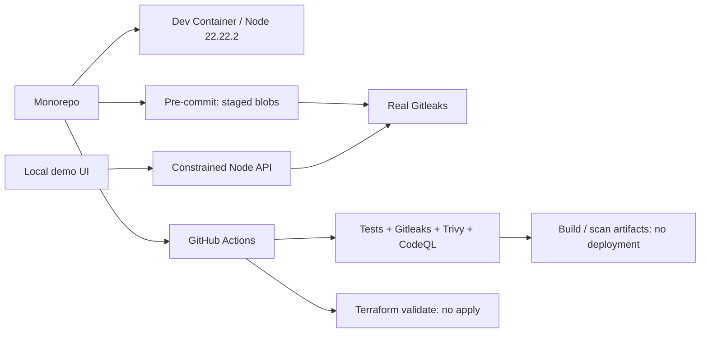

# SENTINEL — Secure Development Platform PoC

> Local proof. Explicit boundaries. A runnable, explainable, cloud-free unified secure development environment.

**Shortest demo path:** On Windows, double-click `start-demo.cmd`, open http://127.0.0.1:4173 in a browser, go to **Live demo**, and click the leak and the fix in order. Do not just show configuration screenshots: both buttons run the real Gitleaks. The **Local AI** tab uses LM Studio on this machine for retrieval-based Q&A; data never leaves the machine.

## Why These Trade-offs

Client requirements are not yet complete. This version validates a technical path of "one repository, one environment, enforceable security gates, and reproducible delivery." It shows a real, closed security loop first, and does not add Kubernetes, cloud accounts, databases, login systems, paid AI, or model training to the demo. **This is not an enterprise development platform in production, and it does not mean all of the client's developers have been moved to a unified environment.**

- Runtime: Node.js **22.22.2**, standard library only, with no third-party npm runtime dependencies.
- Tools: Gitleaks **8.30.1**, Trivy **0.76.1**, Terraform **1.16.6**.
- Cost: the local demo creates no cloud resources and uses no paid APIs. Downloading the tools, container images, and scanner databases the first time requires internet access. Whether later Actions/Codespaces usage is free depends on the repository, the account, and the usage, so unlimited free use cannot be promised.
- Unification: the service `apps/sample-service` and the shared security module `packages/security-policy` are maintained in the same repository. The dev container, CI, and `.nvmrc` are version-aligned.

## Getting Started

### Windows (this machine)

Double-click `start-demo.cmd`, keep the terminal open, and visit http://127.0.0.1:4173. The script prefers the isolated runtime installed on this machine; other computers use Node/Python from PATH. If the port is already in use, first check whether the service is already running, and do not keep starting multiple services.

### Other Computers / Standard Terminal

You need Node 22.22.2, Python 3, and Git. **Showing the web page and the secret-detection loop does not require Docker.**

```sh
python scripts/bootstrap-tools.py gitleaks
node apps/sample-service/server.mjs
```

The Python script uses only the standard library and needs no pip. Some Linux/macOS systems use `python3`. Tools are written only to this repository's `.tools/` folder and do not change the system PATH. Downloads are checked against the SHA256 hash in the official HTTPS manifest before the single executable is extracted. This is not signature verification and not full supply-chain attestation.

Verify in a second terminal:

```sh
node --test
node scripts/smoke.mjs
```

Full local evidence (including checks that the environment may block):

```sh
python scripts/bootstrap-tools.py gitleaks terraform trivy
node scripts/verify.mjs
```

Output goes to `outputs/evidence.json`. Raw `tests.tap` files and redacted demo results are stored under `outputs/runs/<runId>/`, keyed by `runId`. The snapshot is updated atomically when a full batch finishes. If a run fails midway, the previous complete snapshot and its raw evidence are kept, so results from different batches are never mixed. Verifier exit codes: `0` means no failures or blocks, `1` means failures exist, `2` means the environment blocked some checks. `not_run` does not mean passed. The UI's Evidence panel reads the real snapshot and refreshes only when you click refresh; it does not fabricate CI status.

### Dev Container

1. Start Docker Desktop or the Linux Engine, and first confirm that `docker info` returns a server version.
2. Clone this repository. If you downloaded a ZIP, run `git init -b main` first.
3. In VS Code, choose **Reopen in Container** from the Dev Containers extension.
4. Initialization installs the pinned tools and connects the Git hook. Then run `node --test` and `node apps/sample-service/server.mjs`.

The container runs as the non-root `node` user, does not mount the Docker socket, drops capabilities, prohibits privilege escalation, and forwards port 4173 only to localhost. The runtime image has been built and started with a read-only root filesystem, `cap-drop ALL`, a non-root user, and memory/process limits, and its health check passes. A full Dev Container build should be re-run once on the target machine. Image tags and apt repositories are not immutable; in production, pin the image digest, maintain patches, and use controlled sources. Currently only localhost Host/Origin is supported. Do not treat Codespaces public forwarding domains as a supported capability. Codespaces is not a dependency of this version's demo.

## Architecture and Actual Scan Flow



### The Secret-Detection Loop Is Not an Animation

- The backend accepts only two scenarios, `leak` and `clean`. It does not accept user commands, file paths, or arbitrary uploads.
- The synthetic demo token is assembled in memory and passed to Gitleaks via stdin. No raw credentials are stored, and no real client keys are used.
- `.gitleaks.toml` extends the default rules and adds a custom `sentinel-demo-token` rule.
- The web flow uses exit code **42** for a finding and **0** for clean. 42 is reserved for findings, so a fatal error is never mistaken for a successful block.
- The result is validated against both the real scan output and the rule hit. Program errors, timeouts, and missing tools never show green.
- The API returns only the rule ID, the synthetic location, the duration, and the status. It does not return the secret, the match, or raw logs.
- This proves a deterministic gate for synthetic credentials. It does not mean every real key format is detected. The default rules remain enabled.

### Pre-commit

```sh
git init -b main   # only for a ZIP copy without Git yet; not needed when cloning
node scripts/install-hooks.mjs
```

The Python pre-commit framework is not required by default. A `.pre-commit-config.yaml` is provided for teams that already use it. The direct installer does not overwrite existing hooks. The checker reads the **Git staging area contents and its scan policy**, not the working directory. It covers added, modified, renamed, and type-changed files, and scans them via stdin. It has been verified that a staged leak is still blocked even when the fix exists only in the working tree. The PoC's staged-content limit is 16 MiB; larger content is blocked, not silently skipped. The staging area can also be checked in a freshly initialized repository with no commit history.

A local hook can be bypassed by the user, so it is not the final security boundary. Server-side required checks and code review must be added. CI scans the full Git history, while local source verification only checks the current files.

## Local RAG: Data Stays Inside the Network

`docs/knowledge/` holds sample internal policy documents (key management, onboarding, AI usage boundaries, platform boundaries), and the README is indexed along with them. The pipeline is:

```text
Document chunking → local embedding (nomic-embed-text) → local vector index → cosine retrieval, Top 4
        → local Qwen generation → answer with [1][2] source citations
```

Start LM Studio, open its local server (default port 1234), and load one chat model and one embedding model. Tested on this machine: `qwen/qwen3.8-27b` + `text-embedding-nomic-embed-text-v1.5`, 30 chunks, 768 dimensions, about 10–25 seconds per question.

```sh
# Optional: set explicitly (loopback addresses only)
export LM_STUDIO_BASE=http://127.0.0.1:1234/v1
```

**How to verify:**

```sh
node apps/sample-service/server.mjs     # terminal 1
node scripts/rag-smoke.mjs              # terminal 2
```

The script checks that the model is ready, asks one answerable question (the answer must include sources), asks one question the knowledge base does not cover (the answer should say so explicitly), and confirms that non-loopback addresses are rejected. You can also open http://127.0.0.1:4173/#local-ai directly, click an example question, and check the `Egress: Loopback only` label and the source list.

**Enforced constraints, not verbal promises:**

- `assertLoopback()` rejects any inference address other than `127.0.0.1`, `localhost`, or `::1`. A misconfiguration fails immediately and never sends documents out.
- `fetch` uses `redirect: 'error'` to prevent redirects to external hosts.
- Only `docs/knowledge/*.md` and `README.md` are read. File uploads, URLs, and arbitrary paths are not accepted.
- Questions are limited to 400 characters and request bodies to 4 KB, with single concurrency. Cross-origin requests are rejected.
- Answers may only cite retrieved passages. If the material does not say something, the answer must state that the existing material does not cover it. In testing, asking how many days of annual leave the company gives was refused rather than answered with a fabricated figure.

**Limits:** This is retrieval-augmented generation. It does not train or fine-tune any model. There are no accounts, permission inheritance, or audit trail, so it is not equivalent to Copilot Studio. Model output is not a security conclusion. Inside a container, `127.0.0.1` refers to the container itself, so the runtime image cannot reach the host's model by default. This is the expected result of isolation.

## CI / IaC / Container Delivery

`.github/workflows/ci.yml` provides tests, a full-history secret scan, Terraform format/init/validate checks, and Trivy configuration, dependency, and image vulnerability scans, along with short-retention reports. High and critical findings fail the build. Unfixed vulnerabilities are not ignored, and `continue-on-error` is not used. Actions are pinned to full commit SHAs, use minimum permissions, and checkout does not persist credentials.

`.github/workflows/codeql.yml` runs a separate scan of JavaScript/TypeScript. It is disabled by default for private repositories and requires setting `ENABLE_PRIVATE_CODEQL=true` after the license has been verified. Public repositories must also comply with the CodeQL terms of use and the source license conditions. **This work does not decide the open-source license or the public release on the user's behalf.**

This version is **CI plus build/scan delivery artifacts**, with no actual CD deployment. There is no image push, no cloud credentials, no Terraform apply, no Kubernetes, and no cloud billing. The image vulnerability scan may fail because the pinned Node/Debian versions have known vulnerabilities. Upgrade and re-test based on the real results rather than removing the gate.

Terraform uses only the built-in `terraform_data` to express the development contract, with no external providers, remote backend, or cloud resources. `fmt/init/validate` does not verify AWS/Azure permissions or complete resource policies. Zero findings when `terraform_data` does not match any Trivy rule does not mean cloud IaC is covered.

```sh
.tools/terraform -chdir=infra/terraform init -backend=false -input=false
.tools/terraform -chdir=infra/terraform validate
.tools/trivy config --severity HIGH,CRITICAL --exit-code 1 Dockerfile
```

On Windows, use `.tools\terraform.exe` / `.tools\trivy.exe`. Some restricted execution environments block Go tools from reading files. The local demo and staging checks run through the standard stdin path and do not change the security policy. Full Terraform/Trivy file scans should be re-run in a normal development terminal or the Dev Container. Failures are never reported as successes.

```sh
docker compose up --build
```

The runtime image runs as non-root, read-only, with resource limits and capabilities removed. The host binds only `127.0.0.1:4173`. **The slim runtime image does not include scanners, so it only demonstrates the service and its secure runtime configuration. For the real two-button scans, use the local machine or the full Dev Container.** The entire source tree or tools folder is not mounted into the runtime container.

## Remote Repository Protection: Must Be Enabled by an Administrator

- `.github/CODEOWNERS` is currently a commented-out example. It takes effect only after it is replaced with a user or team that actually has the required permissions.
- `.github/branch-protection.template.json` is a REST request body template, not a GitHub configuration file that takes effect automatically.
- After pushing, let CI run first, then set required checks, at least one reviewer, Code Owner approval, blocks on force pushes and deletions, and make sure administrators are bound by the protection rules too.
- Rules and scanning features for private repositories may be limited by the plan. No GitHub remote was configured, nothing was pushed, no PR or commit was created, and no account settings were changed.

## Verification Status and Next Steps

The authoritative sources are `outputs/evidence.json` and the client demo guide. Core items to show live: the page, the health check, real secret blocking and repair, staging-area bypass prevention, the pinned runtime, the restricted container running, and local RAG answers with sources.

Still incomplete, to be completed in the client environment: full Terraform init/validate; Trivy configuration and image vulnerability scans (local Go tools are restricted by the execution environment's file access); actual GitHub Actions/CodeQL runs; enabling branch protection. These stay `blocked` / `not_run` in the evidence and must not be described as complete.

Security limits: there is no authentication and no multi-tenant isolation. It is for local use only; do not expose it to the public internet. CSP, Host/Origin checks, input allowlists, size and concurrency limits, and fixed executable paths are baseline protections for a PoC. They do not replace enterprise SSO/RBAC, auditing, network isolation, artifact signing, or disaster recovery.

## Directory Structure

```text
.devcontainer/             Unified development environment
.github/workflows/         CI and CodeQL
.github/CODEOWNERS         Real owners still to be filled in
infra/terraform/           Zero-cloud-resource development contract
apps/sample-service/       UI, Node service, and tests
packages/security-policy/  Shared real-scan interface
packages/local-rag/        Local embedding, retrieval, and generation
docs/knowledge/            Sample local RAG knowledge base
scripts/                   Install, hooks, verification, browser QA, packaging
outputs/                   Local evidence and delivery packages (not committed to Git)
README.md                  Architecture, security boundaries, and reproduction steps
HANDOFF.md                 Handoff: client requirements mapping, next run steps, known pitfalls
DEMO_GUIDE.md              Five-minute client demo script
```

## Official References

- Dev Container specification: https://containers.dev/implementors/json_reference/
- Gitleaks: https://github.com/gitleaks/gitleaks/tree/v8.30.1
- Trivy: https://trivy.dev/docs/latest/docs/
- Terraform validate: https://developer.hashicorp.com/terraform/cli/commands/validate
- CodeQL availability: https://docs.github.com/en/code-security/concepts/code-scanning/codeql/codeql-code-scanning
- CODEOWNERS: https://docs.github.com/en/repositories/managing-your-repositorys-settings-and-features/customizing-your-repository/about-code-owners
- Branch protection: https://docs.github.com/en/repositories/configuring-branches-and-merges-in-your-repository/managing-protected-branches/about-protected-branches

Versions and usage last verified: 2026-10-21. Do not present this PoC as an implemented client production project.
